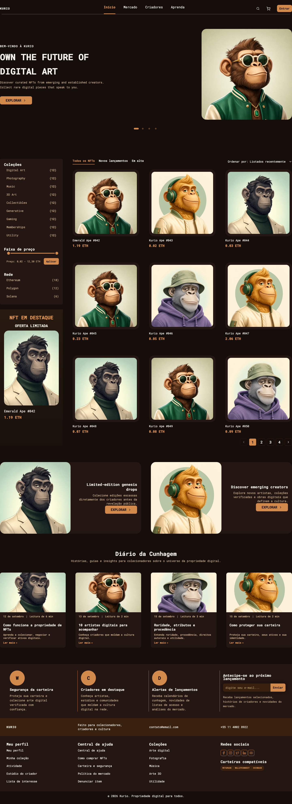
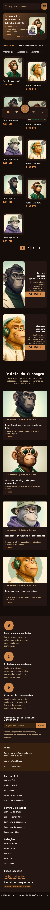
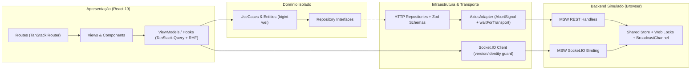

# Kurio — NFT Marketplace

[](https://github.com/joaomaraiaf/kurio-nft-marketplace/actions/workflows/ci.yml)
[](https://github.com/joaomaraiaf/kurio-nft-marketplace/actions/workflows/security.yml)
[](https://github.com/joaomaraiaf/kurio-nft-marketplace/actions/workflows/lighthouse.yml)

Marketplace de NFTs construído em **React 19, TypeScript (strict), TanStack Router/Query e Tailwind CSS 4**, com foco em consistência de estado assíncrono, checkout idempotente recuperável, sincronização realtime multi-aba, acessibilidade e performance.

> **Ambiente de demonstração autônomo:** toda a camada de API REST e eventos Socket.IO roda localmente no navegador via **MSW 2 + `@mswjs/socket.io-binding`**, sem dependências externas. O deploy está configurado para Vercel (pronto para publicação em subdomínio próprio — veja [`docs/DEPLOYMENT.md`](docs/DEPLOYMENT.md)).

| Desktop (`1440×900`) | Mobile (`390×844`) |
| :---: | :---: |
|  |  |

---

## Destaques de Engenharia

- **Aritmética monetária sem ponto flutuante:** valores em ETH são trafegados como strings decimais e calculados com `bigint` em wei (`10^18`), garantindo precisão exata em subtotais, cupons em basis points e taxas estimadas (`src/features/cart/domain/entities/cart-totals.ts`).
- **Checkout idempotente e recuperável:** a chave de idempotência e o payload são gravados antes do `POST /orders`; em caso de timeout (`504`) ou refresh da página, o cliente recupera o mesmo pedido sem duplicar cobrança ou baixa de estoque. Disputas de última unidade entre abas são serializadas com **Web Locks** e os recibos consultam snapshots imutáveis.
- **Realtime multi-aba com proteção contra *race conditions*:** atualizações de preço, estoque e status de pedido trafegam por Socket.IO interceptado pelo MSW, descartam eventos duplicados ou com versão inferior, protegem callbacks atrasados contra troca de conta e reconciliam recursos ativos via REST na reconexão.
- **Performance com pré-renderização pública no build Vite:** as rotas públicas (`/` e `/market/nft-001`) são pré-renderizadas em Node usando os mesmos componentes e handlers REST MSW, hidratando antes do Service Worker subir (`waitForTransport()` na camada HTTP/WS). Resultado auditado: **Lighthouse Performance 94/98 no mobile e 100/100 no desktop** (`CLS 0.0000`, `TBT ≤ 49 ms`) — [medianas em `docs/audits/lighthouse/summary.md`](docs/audits/lighthouse/summary.md).
- **Qualidade, acessibilidade e supply-chain hardening:** Biome estrito (`--error-on-warnings`, `noExplicitAny`, `useExhaustiveDependencies`, `noNonNullAssertion`), **106 testes Vitest**, **117 testes E2E Playwright** (sem `waitForTimeout`), 12 baselines de regressão visual, matriz de acessibilidade com `axe-core`, CodeQL e proteções de supply chain no pnpm 11 (`minimumReleaseAge`, `blockExoticSubdeps`, `strictDepBuilds`).

---

## Arquitetura

Arquitetura **Feature-first + Clean Architecture + MVVM** com fronteiras estritas: o domínio (`domain/`) não importa React, hooks ou infraestrutura, e `core/` não importa `features/`. Schemas **Zod** validam todas as bordas HTTP e WebSocket; rotas e diálogos pesados são carregados sob demanda.



```text
src/
  core/        HTTP (AxiosAdapter), realtime, layout desacoplado, UI base e ErrorBoundary global
  features/    activity, auth, cart, catalog, favorites, market, orders, payment, profile, quotes, wallets
  mocks/       MSW REST/Socket.IO, engine de cotação/pedidos, Web Locks e cenários determinísticos
  routes/      definição de rotas TanStack Router, guards de sessão e composição lazy
tests/         suíte Playwright E2E, acessibilidade (axe-core) e 12 baselines visuais
docs/          ADRs, contratos REST/WS, validação reproduzível e cenários de demonstração
guides/        guardrails modulares de engenharia e revisão (context engineering com AGENTS.md)
```

Decisões detalhadas em [ARCHITECTURE.md](ARCHITECTURE.md) e nos [ADRs](docs/ADRs/).

---

## Quickstart

Requisitos: **Node.js `>= 22.19`** (`24` recomendado, definido em `.node-version`) e **pnpm `11.5.2`**.

```bash
pnpm install --frozen-lockfile
pnpm dev
```

Acesse [http://127.0.0.1:3002](http://127.0.0.1:3002). O modo `dev` inicia automaticamente os mocks locais (MSW + Socket.IO).

### Contas de demonstração

Também é possível criar uma nova conta local pela interface.

| Usuário | E-mail | Senha |
| --- | --- | --- |
| `AliceDemo` | `alice@kurio.test` | `Kurio123!` |
| `BrunoDemo` | `bruno@kurio.test` | `Kurio123!` |

### Comandos principais

```bash
pnpm lint                # Biome (--error-on-warnings)
pnpm typecheck           # TypeScript strict (tsc --noEmit)
pnpm test                # Vitest (unitários e integração)
pnpm test:cov            # Vitest com relatório de cobertura V8
pnpm build:mock          # typecheck + build com pré-renderização pública e MSW
pnpm test:e2e            # suíte E2E Playwright (Chromium desktop/mobile/tablet)
pnpm test:visual         # regressão visual contra as 12 baselines
pnpm audit:lighthouse    # 12 auditorias Lighthouse (mobile e desktop)
pnpm generate <feature>  # scaffold de nova feature seguindo os padrões do projeto
```

---

## Trade-offs e Limitações (vs. Produção com Backend Real)

Esta aplicação é uma **SPA demonstrativa autocontida** — não há servidor backend, blockchain real ou gateway de pagamento. Ao conectar o frontend a uma API real, o plano de transição é direto graças ao isolamento em `data/` e `core/api/`:

- **Autenticação e sessão:** hoje contas e perfis ficam em `localStorage` (PBKDF2 com salt) e a sessão por aba em `sessionStorage`. Em produção, a sessão deve migrar para cookies `HttpOnly` + `Secure` + `SameSite=Lax` com proteção CSRF e revogação server-side.
- **Desacoplamento dos mocks:** basta compilar com `pnpm build` (`VITE_MOCKS_ENABLED=false`) e apontar `VITE_API_URL` e `VITE_SOCKET_URL` para a API/gateway real; o bundle de produção exclui o bootstrap do MSW.
- **CSP estrita:** `vercel.json` aplica headers de hardening (`X-Content-Type-Options`, `X-Frame-Options`, `Referrer-Policy`, `Permissions-Policy`). Para habilitar `Content-Security-Policy` sem `'unsafe-inline'`, os scripts inline de preload/hidratação de snapshot em `index.html` e `scripts/public-catalog-snapshot.ts` seriam movidos para arquivos externos ou assinados com nonce/hash no edge.
- **Realtime entre dispositivos:** `BroadcastChannel` e Web Locks sincronizam apenas abas da mesma origem no mesmo navegador; em produção, o servidor Socket.IO assume rooms autenticadas e pub/sub distribuído (ex.: Redis adapter).

---

<details>
<summary><strong>Simulação de falhas de rede, concorrência e cenários de checkout (Console)</strong></summary>

Com a aplicação aberta no navegador, o MSW expõe endpoints `/api/__mock/*` para testar cenários determinísticos sem ferramentas externas:

```js
window.setMockControl = async (control, payload) => {
  const response = await fetch(`/api/__mock/${control}`, {
    method: 'POST',
    headers: { 'Content-Type': 'application/json' },
    body: JSON.stringify(payload),
  });
  if (!response.ok) throw new Error(`Controle mock falhou: ${response.status}`);
};

// Exemplos rápidos:
await setMockControl('reset', { scenario: 'slow' });          // latência de 1,5s no catálogo
await setMockControl('checkout', { scenario: 'refused' });    // recusa terminal de pagamento
await setMockControl('checkout', { scenario: 'timeout-after-create' }); // timeout 504 recuperável
await setMockControl('auth/expire-session', {});              // expiração de sessão com retomada
await setMockControl('reset', { scenario: 'default' });       // restaurar estado inicial
```

Consulte o guia completo de cenários, cupons (`KURIO10`, `EXPIRADO`), gates de rede e eventos realtime em [`docs/DEMO_SCENARIOS.md`](docs/DEMO_SCENARIOS.md).

</details>

## Documentação Adicional

- [Arquitetura](ARCHITECTURE.md) e [ADRs](docs/ADRs/)
- [Contratos REST e Socket.IO](docs/API_CONTRACTS.md) · [Contratos de comércio](docs/COMMERCE_CONTRACTS.md)
- [Cenários de demonstração](docs/DEMO_SCENARIOS.md) · [Validação reproduzível](docs/VALIDATION.md)
- [Auditorias Lighthouse](docs/audits/README.md) · [CI e proteção de branches](docs/CI.md) · [Deploy na Vercel](docs/DEPLOYMENT.md)
- [AGENTS.md](AGENTS.md) e [guias modulares](guides/)
